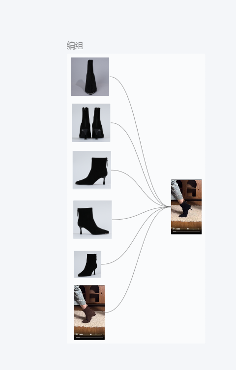

# 用户指定的无限画布排版

以用户2026-11-14提供的下图为排版标准；这是用户的布局要求，不代表已验证所有编组或对齐操作入口。

## 布局关系

- **左列为输入**：同款商品图从上到下整齐排列，左边缘对齐、图与图之间留出相近空隙；原视频放在商品图下方，作为左列最底部的视频节点。节点保留图片/视频原比例，不为统一尺寸裁切或修改素材。
- **右侧居中为生成节点或其结果**：与左列留出可辨认连线的横向距离，位置对齐整列输入的中段。不要把生成结果插入商品图之间，也不要把输入散放在结果周围。
- **连线从左向右汇入**：商品图及原视频从右侧输出口接入右侧生成节点的左侧输入口，形成图中的汇聚结构。图片在画布上的上下次序不是模型引用编号，最终仍打开面板核对实际图序。
- **一件任务一个编组**：将本任务商品图、原视频、生成节点/结果放在同一个编组范围内，与其他任务留白分隔。可以按实际货号、颜色和批次命名，不能混入其他款的素材或移动未知节点。
- 截图展示5张商品图是该示例的素材量，**不是固定只传5张或只连5张**。按本任务真实素材清单与已确定的引用方案排列；不为模仿张数删除、漏传或减少必要角度。辅助细节图仍放左侧并标清身份，未连接的图不伪造连线。

## 放置顺序与续跑

1. 先确认当前画布、已有本任务节点和空地。按输入左列、输出右侧的结构一次预留区域；上传后直接摆在目标列，避免全部上传完再搬动两遍。
2. 先整理本任务输入左列，原视频在底部；生成节点置于右侧中间后再连线，减少连好后移动导致视野和端口位置变化。仅上传任务只整理输入并预留右侧空位，不自行建立或提交生成。旧成功分组的素材、参数、引用、连线、名称、位置和结果全部保留。
3. UI提供已确认的多选/编组或对齐入口时使用；入口未知时先核实实际菜单，不猜快捷键、不拿全画布全选试验。不能完成实际编组时说明“布局已整理，应用编组未确认”，不把摆放相近当作编组成功。
4. 新来源必须在新空白区建立独立组，使用全新素材副本/本地原图上传及新生成节点；不连接或改动旧成功组。仅同一新任务组续跑时复用它已有节点和连线、只补缺失。移动已有已连接节点后核对引用仍在，不删除结果来整理版面。
5. 480测试与1080结果均保留；需要展示两个结果时放在右侧，标清阶段、留出间距，可向右扩展编组，不用1080覆盖480，也不把480接成默认唯一源输入。

## 完成检查

一次总览确认：左侧商品图为同款且没有重叠、原视频在左下、生成/结果在右侧、引用线指向正确节点、编组范围只含本任务。再用实际引用列表核对连接；排版整齐不能替代上传完整性、参数和质量验收。

用户只提供排版标准或要求维护流程时，更新本规则即可，不据此移动当前画布上的未知任务，也不提交生成。
